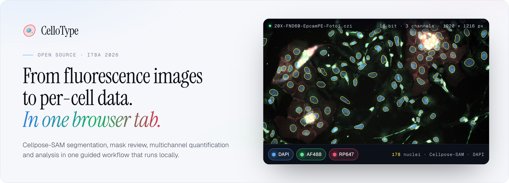
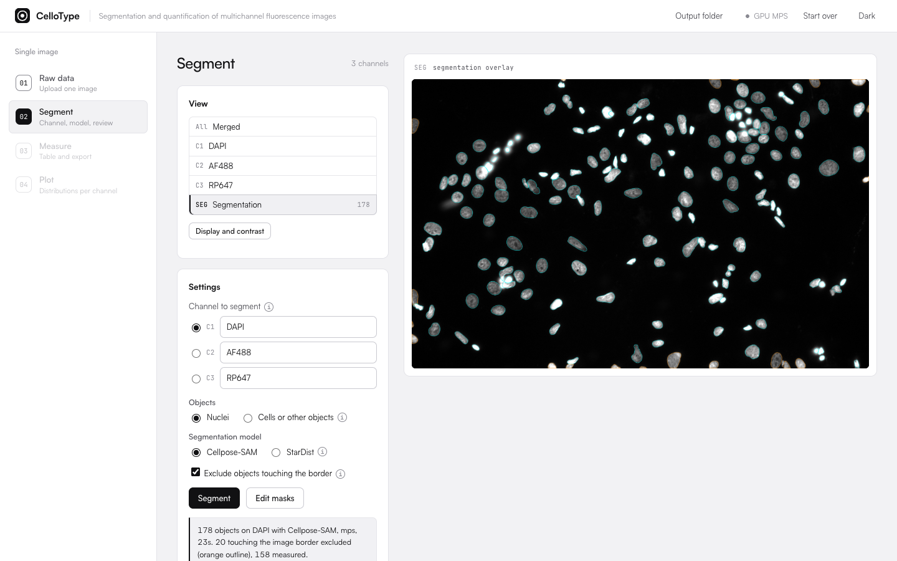
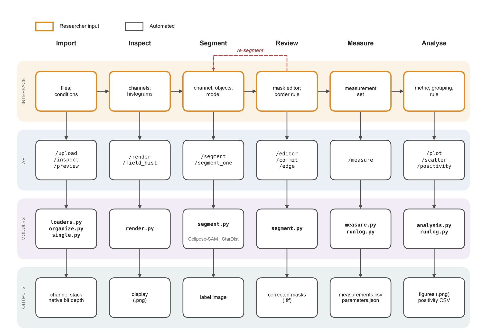
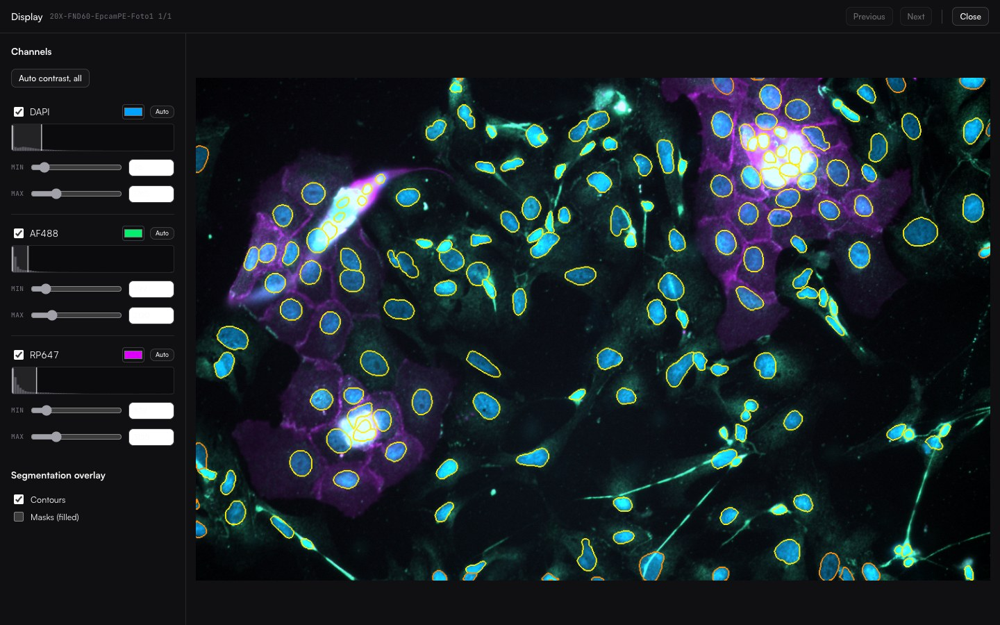
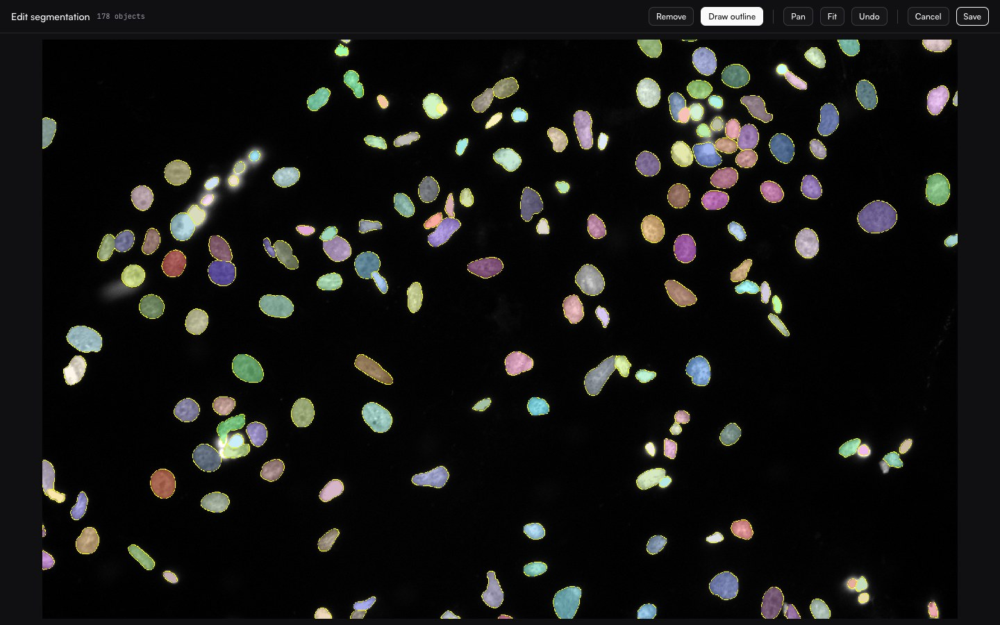
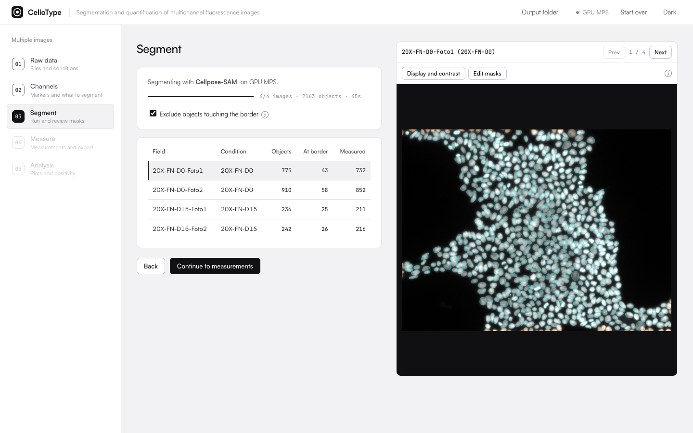
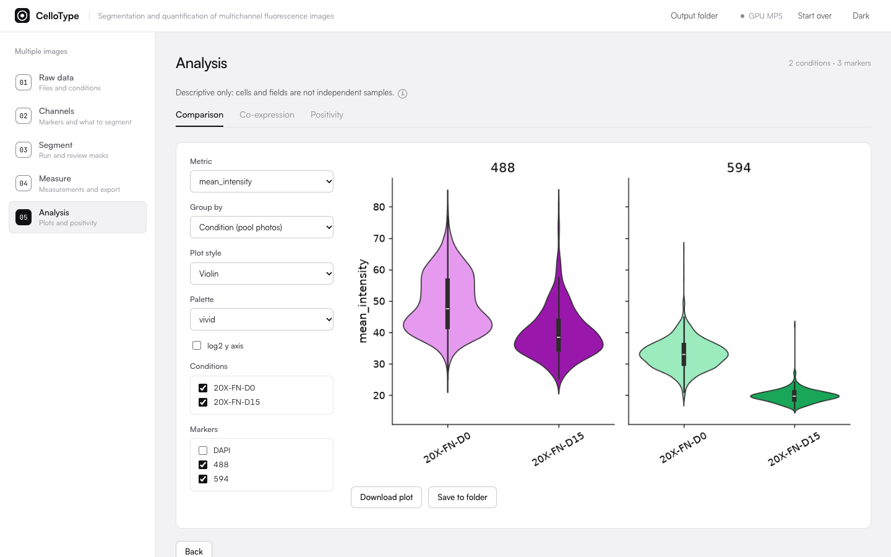
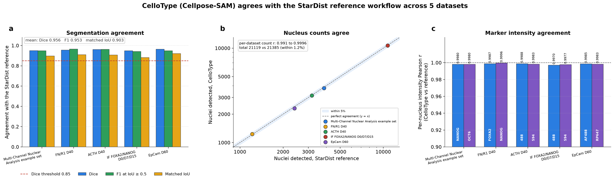

<p align="center">
  <picture>
    <source media="(prefers-color-scheme: dark)" srcset="docs/assets/banner-dark.png">
    
  </picture>
</p>

<p align="center">
  
  
  
  <a href="LICENSE"></a>
</p>

<p align="center">
  <a href="#how-it-works">How it works</a> &nbsp;·&nbsp;
  <a href="#installation">Installation</a> &nbsp;·&nbsp;
  <a href="#usage">Usage</a> &nbsp;·&nbsp;
  <a href="#outputs">Outputs</a> &nbsp;·&nbsp;
  <a href="#agreement-with-a-reference-workflow">Agreement study</a> &nbsp;·&nbsp;
  <a href="#documentation">Documentation</a> &nbsp;·&nbsp;
  <a href="#citation">Citation</a>
</p>

**CelloType** is a local web application for the quantitative analysis of multichannel
fluorescence microscopy images. It takes a dataset from raw files to per-object measurements in
one guided workflow: fields are organised into conditions, nuclei or cells are segmented with
Cellpose-SAM, every mask is reviewed, every channel is measured with the same masks, and
conditions are compared. It runs on localhost, and images never leave the machine.

Mechanical steps are automated. Experimental decisions stay with the researcher and are recorded
next to the results.

<picture>
  <source media="(prefers-color-scheme: dark)" srcset="docs/assets/screen-segment-dark.png">
  
</picture>
<p align="center"><sub>Segment step. 178 nuclei on the DAPI channel with Cellpose-SAM in 23 s on an Apple GPU; the 20 that touch the image border are excluded and 158 are measured.</sub></p>

## Highlights

- **Quantitative input.** CZI, TIFF (OME or ImageJ) and PNG/JPEG, read at native bit depth, with
  channel names and pixel size taken from the metadata.
- **Segmentation of any channel.** Cellpose-SAM for nuclei, cells or other objects, on NVIDIA
  (CUDA) or Apple Silicon (MPS) GPUs with a CPU fallback. Optional StarDist for nuclei.
- **Review before measurement.** Every mask can be inspected and edited in the browser. Only the
  corrected masks are measured.
- **Per-object quantification.** 18 ImageJ-style measurements on every channel, sizes in µm,
  optional background subtraction, and objects touching the border excluded by default.
- **Analysis by condition.** Distributions, co-expression and positivity against a control
  condition, as descriptive statistics.
- **Reproducible results.** Every table can be exported with a JSON record of how it was produced
  and with the final label masks.

## How it works

<p align="center">
  
</p>
<p align="center"><sub>Steps of the multiple-image flow. Orange outlines mark decisions taken by the researcher; grey outlines, automated steps. Masks are reviewed and edited before anything is measured (dashed red: back to segmentation). The single-image flow has no dataset organisation and no positivity.</sub></p>

<p align="center">
  
</p>
<p align="center"><sub>Architecture. At each stage the interface sends a request to a FastAPI endpoint (under <code>/api</code>), a Python module does the work, and its output feeds the next stage. Details in <a href="docs/ARCHITECTURE.md">docs/ARCHITECTURE.md</a>.</sub></p>

## Installation

**Requirements.** Python 3.10 to 3.12. A GPU is optional but strongly recommended (NVIDIA CUDA or
Apple Silicon MPS). About 1.2 GB of disk for the Cellpose-SAM weights, downloaded to
`~/.cellpose` on first use.

```bash
git clone https://github.com/abrilcode/CelloType.git
cd CelloType

python3 -m venv .venv
source .venv/bin/activate          # Windows (PowerShell): .venv\Scripts\Activate.ps1

pip install --upgrade pip
pip install -r requirements.txt
```

On an NVIDIA GPU, install the [CUDA build of PyTorch](https://pytorch.org/get-started/locally/)
that matches the driver before `requirements.txt`. On Apple Silicon the default install already
uses the GPU.

**Optional: StarDist for nuclei.** `pip install stardist tensorflow` adds StarDist
(`2D_versatile_fluo`, with the settings of the reference workflow) as a second model when the
objects are nuclei.

## Usage

```bash
uvicorn app:app --host 127.0.0.1 --port 8010
```

Open http://127.0.0.1:8010 and choose a flow: **Single image** for one field, or **Multiple
images** for a dataset organised into experimental conditions.

| Step | What happens | Decided by the researcher |
|---|---|---|
| **1.&nbsp;Raw&nbsp;data** | Files are read and grouped into fields; each field is assigned to a condition. | Files, conditions |
| **2.&nbsp;Channels** | Marker names, the channel to segment, the object type and the model. | Channel, object type, model |
| **3.&nbsp;Segment** | Every field is segmented with progress and timing; masks are reviewed and edited. | Border rule, mask edits |
| **4.&nbsp;Measure** | The same masks are measured on every channel. | Measurements, background, pixel size |
| **5.&nbsp;Analysis** | Distributions, co-expression and positivity by condition. | Plots, positivity rule, control |

The single-image flow has four steps (Raw data, Segment, Measure, Plot), with the channel, object
type and model chosen in the Segment step.

<table>
  <tr>
    <td width="50%" valign="top">
      
      <br><sub><b>Display and contrast.</b> Per-channel colour, histogram and range, as in ImageJ. Display settings never change the measured values.</sub>
    </td>
    <td width="50%" valign="top">
      
      <br><sub><b>Mask editor.</b> Remove spurious objects, draw missing ones and undo. The corrected mask is the one that is measured.</sub>
    </td>
  </tr>
  <tr>
    <td width="50%" valign="top">
      <picture>
        <source media="(prefers-color-scheme: dark)" srcset="docs/assets/screen-batch-segment-dark.png">
        
      </picture>
      <br><sub><b>Batch segmentation.</b> Every field in one pass, with objects detected, at the border and measured per field.</sub>
    </td>
    <td width="50%" valign="top">
      <picture>
        <source media="(prefers-color-scheme: dark)" srcset="docs/assets/screen-analysis-dark.png">
        
      </picture>
      <br><sub><b>Analysis.</b> Violin or box plots of any measurement by condition or field, co-expression and positivity.</sub>
    </td>
  </tr>
</table>

## Outputs

| File | Contents |
|---|---|
| `measurements.csv` | One row per object and channel, with the selected measurements. |
| `<table>_parameters.json` | Inputs, settings, mask edits and software versions, and whether the result can be reproduced from the parameters alone. |
| Masks | The final label image as TIFF (single image), or one TIFF per field in a ZIP (batch). |
| `cells_positive.csv` | Positivity per object and marker (batch). |
| Plots | PNG figures of each analysis view. |

Columns, measurements and the parameter record are described in [docs/OUTPUTS.md](docs/OUTPUTS.md).
Changes to the output format since the evaluated version are listed in [CHANGELOG.md](CHANGELOG.md).

## Agreement with a reference workflow

CelloType's nuclear segmentation and per-nucleus readouts were compared with a published
StarDist-based workflow, Multi-Channel Nuclear Analysis (Waisman, 2025), on the same images: five
datasets, 78 fields and 21,385 reference nuclei. Both mask sets were measured with the same code,
so differences reflect the segmented regions only.

<p align="center">
  
</p>
<p align="center"><sub>(a) Dice, F1 at IoU ≥ 0.5 and matched IoU per dataset, against the 0.85 threshold. (b) Nuclei detected by CelloType against the reference; the band is ±5 %. (c) Pearson r of per-nucleus mean intensity for each marker, on matched nuclei.</sub></p>

Every dataset met the thresholds set before the comparison: Dice 0.948 to 0.964, F1 at
IoU ≥ 0.5 0.942 to 0.965, nucleus-count r 0.991 to 0.9996, and per-nucleus marker intensity r
0.997 to 0.9996. This is agreement between two automatic methods, not accuracy against manual
annotation. On these nuclear images Cellpose-SAM was 15 to 37 times slower than StarDist. Method,
per-dataset results and timing: [docs/VALIDATION.md](docs/VALIDATION.md).

## Documentation

| Document | Contents |
|---|---|
| [docs/VALIDATION.md](docs/VALIDATION.md) | Agreement study: method, thresholds, per-dataset results and timing |
| [docs/OUTPUTS.md](docs/OUTPUTS.md) | Output files, columns, measurements and the parameter record |
| [docs/ARCHITECTURE.md](docs/ARCHITECTURE.md) | Modules by layer and how the application is organised |
| [CHANGELOG.md](CHANGELOG.md) | Changes since the version evaluated in the thesis |

## Data and privacy

CelloType runs entirely on the local machine and does not upload images. Microscopy images and
patient-derived data must not be committed to this repository; the `.gitignore` excludes common
microscopy formats as a safety net. CelloType is research software and is not intended for
diagnostic use.

## Citation

CelloType was developed by Abril Herrlein as the final project of the Bioengineering degree at
the Instituto Tecnológico de Buenos Aires (ITBA), supervised by Dra. María Andrea Camilletti.
The citation metadata is in [CITATION.cff](CITATION.cff), which GitHub shows under "Cite this
repository".

> A. Herrlein, "Desarrollo de una plataforma web para segmentación y cuantificación de imágenes
> de fluorescencia multicanal," Proyecto final de carrera, Bioingeniería, Instituto Tecnológico
> de Buenos Aires, 2026.

Work that uses CelloType should also cite the models behind its results:

- **Cellpose-SAM.** M. Pachitariu, M. Rariden and C. Stringer, "Cellpose-SAM: superhuman
  generalization for cellular segmentation," bioRxiv, 2025, doi:10.1101/2025.04.28.651001.
- **Cellpose.** C. Stringer, T. Wang, M. Michaelos and M. Pachitariu, "Cellpose: a generalist
  algorithm for cellular segmentation," Nature Methods 18, 100 to 106, 2021,
  doi:10.1038/s41592-020-01018-x.
- **StarDist**, when the StarDist option was used. U. Schmidt, M. Weigert, C. Broaddus and
  G. Myers, "Cell Detection with Star-Convex Polygons," MICCAI 2018,
  doi:10.1007/978-3-030-00934-2_30; and M. Weigert et al., WACV 2020.

Reference workflow of the agreement study: A. Waisman, "Multi-Channel Nuclear Analysis: An
ImageJ/FIJI Plugin for Automated Nuclear Segmentation and Multi-Channel Fluorescence Analysis,"
microPublication Biology, 2025, doi:10.17912/micropub.biology.001590.

## License

Released under the [MIT License](LICENSE).
