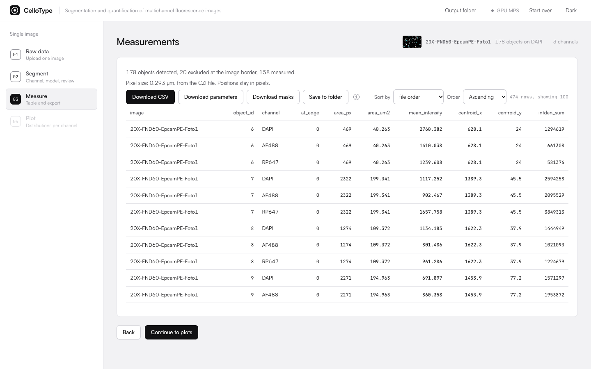

# Outputs

Every result CelloType produces is a plain file: a CSV table, a JSON record of how the table was
made, the final label masks and PNG plots. This page describes each one.

<picture>
  <source media="(prefers-color-scheme: dark)" srcset="assets/screen-measure-dark.png">
  
</picture>

Measure step. The pixel size (0.293 µm) comes from the CZI metadata, so areas are reported in µm² next to the pixel values.

## Files

| File | Contents |
|---|---|
| `measurements.csv` | One row per object and channel: image, condition and technical replicate (batch), object id, channel, `at_edge`, and the selected measurements. |
| `<table>_parameters.json` | How the table was produced: input files and planes, segmentation channel, object type, model and settings, size reduction, border rule, mask edits, pixel size, background method and software versions. It states whether the result can be reproduced from the parameters alone (not when masks were edited by hand). |
| Masks | The final label image as TIFF (single image), or one TIFF per field in a ZIP (batch). |
| `cells_positive.csv` | Positivity per object and marker (batch), with its own `_parameters.json`. |
| Plots | PNG figures of the comparison, co-expression and positivity views. |

The "Save to folder" option writes the CSV and its parameter record together into a folder
chosen in the browser.

## Measurements

The measurement set follows ImageJ/Fiji "Set Measurements". Geometry does not depend on the
channel; intensity measurements are computed on every channel at native bit depth. The table is
tidy: one row per object and channel, with only the selected columns. Area, centroid, mean
gray value and integrated density are selected by default.

| Measurement | Type | Columns |
|---|---|---|
| Area | geometry | `area_px`, `area_um2` |
| Mean gray value | intensity | `mean_intensity` |
| Standard deviation | intensity | `std_intensity` |
| Modal gray value | intensity | `mode_intensity` |
| Min and max gray value | intensity | `min_intensity`, `max_intensity` |
| Centroid | geometry | `centroid_x`, `centroid_y` |
| Center of mass | intensity | `com_x`, `com_y` |
| Perimeter | geometry | `perimeter`, `perimeter_um` |
| Bounding rectangle | geometry | `bbox_x`, `bbox_y`, `bbox_w`, `bbox_h` |
| Fit ellipse | geometry | `ellipse_major`, `ellipse_minor`, `ellipse_angle`, `ellipse_major_um`, `ellipse_minor_um` |
| Shape descriptors | geometry | `circularity`, `aspect_ratio`, `roundness`, `solidity` |
| Feret's diameter (max) | geometry | `feret_max`, `feret_max_um` |
| Integrated density | intensity | `intden_sum` |
| Median | intensity | `median_intensity` |
| Skewness | intensity | `skewness` |
| Kurtosis | intensity | `kurtosis` |
| Area fraction (above Otsu) | intensity | `area_fraction_pct` |
| Stack position (channel index) | geometry | `stack_position` |

## Units

With a known pixel size (from the CZI, OME or ImageJ metadata, or entered manually when the file
has none), sizes are also reported in µm and µm², next to the pixel columns. Without one, the µm
columns are empty. Positions (centroid, center of mass, bounding box) stay in pixels because they
locate the object in the image. Lengths need square pixels; with non-square pixels only
`area_um2` is filled.

## Border objects

Objects touching the image border are excluded by default and marked with `at_edge` = 1. The rule
can be changed after segmentation without segmenting again.

## Background subtraction

Optional, per channel. The median of the pixels outside every object, beyond a 5 px guard band,
is subtracted from each object's mean and integrated density, and the subtracted value is written
in a `background` column. The agreement study used no background subtraction.
